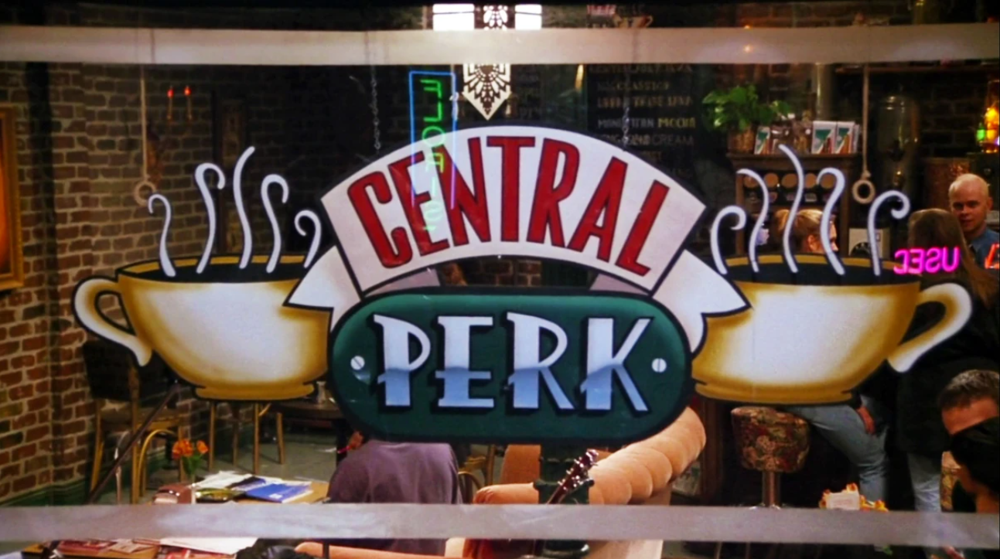
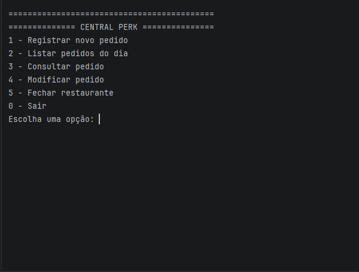

# Central Perk — Sistema de gerenciamento de pedidos de restaurante



> Um sistema de linha de comando inspirado na cafeteria **Central Perk**, da série *Friends*.
A aplicação permite registrar e acompanhar pedidos, personalizar itens do cardápio e realizar o fechamento financeiro do dia.

## Sobre o projeto

O Central Perk é uma aplicação de terminal que simula o funcionamento de uma cafeteria, desde o registro de pedidos até o fechamento do caixa. Por meio de um menu interativo, é possível cadastrar pedidos vinculados a clientes, selecionar e personalizar itens do cardápio, acompanhar alterações e consultar o histórico de atendimentos.

Cada pedido recebe um identificador próprio, facilitando sua consulta e gerenciamento. Os itens podem receber adicionais específicos, ter seu tamanho alterado e ser removidos conforme as escolhas do cliente.

Desenvolvido como projeto acadêmico, o sistema aplica conceitos de programação orientada a objetos, organização de código, padrões de projeto, coleções e testes automatizados com JUnit.

## Cardápio temático

O cardápio reúne referências a comidas, bebidas e cenas memoráveis da série *Friends*.

| Item                              |    Preço |
|-----------------------------------|---------:|
| Trifle da Rachel                  | R$ 22,00 |
| Sanduíche MoistMaker do Ross      | R$ 28,00 |
| Doces da Monica                   | R$ 12,00 |
| Cheesecake do Chão                | R$ 18,00 |
| Pizza do Joey                     | R$ 32,00 |
| Biscoitos da Avó da Phoebe        | R$ 10,00 |
| Café Comum (ou seja, tamanho normal fora de Friends) | R$ 06,00 |
| Café Gigante do Central Perk      | R$ 14,00 |
| Margaritas do Ross                | R$ 18,00 |

## Funcionalidades

- Cadastro de pedidos com identificação numérica automática e associação ao nome do cliente.
- Consulta individual e listagem dos pedidos, incluindo o histórico de pedidos cancelados.
- Seleção de produtos do cardápio e inclusão de múltiplos itens em um pedido.
- Personalização individual dos itens, com seleção de adicionais específicos para cada produto.
- Aplicação de acréscimos de preço conforme os adicionais selecionados.
- Alteração de tamanho para produtos que disponibilizam essa opção.
- Inclusão e remoção de itens em pedidos existentes, além do cancelamento de pedidos.
- Atualização dos valores das transações após modificações nos pedidos.
- Registro de gorjetas e gerenciamento das transações financeiras.
- Fechamento diário com apresentação do total de vendas, das gorjetas e do valor total em caixa.
- Identificação das combinações personalizadas distintas e dos produtos-base comercializados.
- Validação de entradas e tratamento de opções inválidas, permitindo a continuidade da execução.

##  Organização do projeto

O código está dividido em pacotes de acordo com suas responsabilidades:

```text
src/
├── main/
│   └── java/br/com/
│       ├── app/
│       │   ├── Main.java
│       │   ├── ConsoleMenu.java
│       │   └── RestaurantFacade.java
│       ├── financial/
│       │   ├── CashRegister.java
│       │   └── Transaction.java
│       ├── menu/
│       │   ├── MenuItem.java
│       │   ├── Food.java
│       │   ├── Drink.java
│       │   ├── MenuFactory.java
│       │   └── decorator/
│       │       ├── WithExtraIngredient.java
│       │       └── WithLargeSize.java
│       ├── order/
│       │   ├── Order.java
│       │   └── OrderManager.java
│       └── utils/
│           ├── Constants.java
│           └── Messages.java
└── test/
    └── java/br/com/
        ├── app/
        ├── financial/
        ├── menu/
        └── order/
```

## ▶ Como executar

1. Clone o repositório por linha de comando:

   ```bash
   git clone <URL_DO_REPOSITORIO>
   ```

2. Abra o projeto no IntelliJ IDEA.

3. Para iniciar a aplicação, localize a classe `Main.java`, no pacote `br.com.app`, e execute o método `main()`.

A aplicação será iniciada no terminal integrado da IDE e apresentará o menu principal para registrar, consultar e modificar pedidos ou realizar o fechamento do restaurante.

## Demonstração



## Principais responsabilidades

- **`Main`**: inicializa a aplicação e controla o fluxo principal, delegando as operações à fachada e ao menu.
- **`ConsoleMenu`**: realiza a leitura e validação das entradas do usuário e apresenta menus, pedidos e relatórios.
- **`RestaurantFacade`**: centraliza a comunicação entre o gerenciamento de pedidos, o cardápio e o caixa.
- **`MenuFactory`**: centraliza a criação dos produtos e a aplicação das personalizações disponíveis.
- **`MenuItem`**: define a interface comum para os itens do cardápio.
- **`Food` e `Drink`**: representam as categorias de produtos oferecidas pela cafeteria.
- **`WithExtraIngredient` e `WithLargeSize`**: implementam decorações que acrescentam características e custos aos itens.
- **`Order` e `OrderManager`**: representam uma comanda e gerenciam o conjunto de pedidos do sistema.
- **`CashRegister` e `Transaction`**: gerenciam os registros financeiros, as gorjetas e os valores utilizados no fechamento.

Os adicionais e seus respectivos preços são apresentados durante a interação com o menu, de acordo com o item selecionado. A pizza também permite escolher o tamanho grande. Afinal, **Joey doesn't share food!**

## Requisitos do projeto

O desenvolvimento foi organizado em etapas, acompanhando os níveis definidos no enunciado do Projeto 1.

### Nível 1 — Estrutura e gerenciamento de pedidos

- Implementação de pedidos com identificador numérico e nome do cliente.
- Gerenciamento centralizado dos pedidos, com geração automática de identificadores.
- Criação de uma interface de terminal para interação com o usuário.
- Separação entre a lógica de negócio, a interface e a coordenação das operações.
- Cálculo dos valores dos pedidos e gerenciamento de seu histórico.

### Nível 2 — Cardápio e personalização

- Definição da interface `MenuItem` para representar os itens do cardápio.
- Implementação da `MenuFactory` para centralizar a criação dos produtos.
- Aplicação do padrão Decorator para adicionar ingredientes e características aos produtos.
- Implementação de testes automatizados para validações e cálculos de preços.

### Nível 3 — Gerenciamento e personalização avançada

- Personalização dos lanches por meio da retirada de ingredientes, sem alteração do preço original.
- Inclusão e remoção de itens em pedidos existentes.
- Cancelamento de pedidos e atualização dos valores correspondentes.
- Identificação de combinações distintas por meio de coleções do tipo `HashSet`.
- Tratamento de entradas numéricas inválidas e opções inexistentes.

### Funcionalidades adicionais — Bônus

- Registro de gorjetas e geração de relatório financeiro.
- Implementação das classes `CashRegister` e `Transaction`.
- Utilização de `HashSet` para armazenar transações, com implementação de `equals()` e `hashCode()`.
- Contabilização dos produtos-base comercializados, independentemente dos adicionais aplicados.
- Ampliação da suíte de testes automatizados para contemplar diferentes regras de negócio.

## Conceitos e padrões aplicados

- **Programação orientada a objetos:** aplicação de encapsulamento, abstração e separação de responsabilidades.
- **Interface (`MenuItem`):** estabelece um contrato comum para diferentes tipos de itens do cardápio.
- **Factory (`MenuFactory`):** centraliza a criação dos produtos.
- **Decorator (`WithExtraIngredient` e `WithLargeSize`):**  permite adicionar ingredientes e alterar características dos itens sem modificar suas classes concretas.
- **Collections:** utilização de `Map`, `List` e `Set` para organizar pedidos, histórico e combinações distintas.
- **JUnit 5:** utilização de testes automatizados para verificar regras de negócio, validações, personalizações, pedidos e transações.

## ️ Tecnologias e requisitos

- Java 17 ou superior.
- Maven.
- JUnit 5.10.2 para execução dos testes.

## Testes

Os testes automatizados estão em `src/test/java` e utilizam JUnit 5.

Para executar toda a suíte:

```bash
mvn test
```

Os testes cobrem, entre outros cenários:

- Criação e validação de pedidos e itens.
- Criação de itens do cardápio e aplicação de adicionais.
- Cálculo dos valores após personalizações.
- Inclusão, remoção e cancelamento de itens e pedidos.
- Identificação de combinações distintas.
- Registro, atualização e remoção de transações.
- Cálculo de vendas, gorjetas e total em caixa.


## Vídeo de apresentação

Vídeo de apresentação e demonstração do projeto - [Link](<URL_DO_VIDEO>)

## Histórico de implementação

Descripton - [feat: impl initial project requirements](<URL_DO_COMMIT>)

Descripton - [feat: impl item customization and decorators](<URL_DO_COMMIT>)

Descripton - [feat: enhance order management and item customization](<URL_DO_COMMIT>)

Descripton - [feat: add factory, menu customization and financial transactions](<URL_DO_COMMIT>)

Descripton - [feat: customize application with Friends theme](<URL_DO_COMMIT>)

Descripton - [test: add unit tests](<URL_DO_COMMIT>)